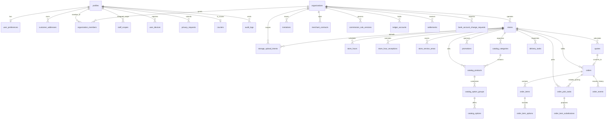
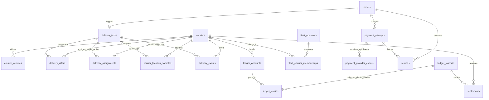
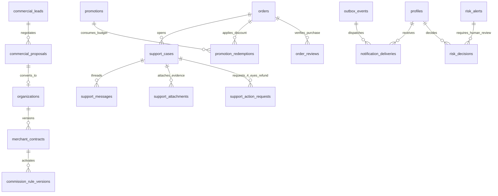

# iDeliveryFood — Entity-Relationship Diagram (ERD) (`M00`–`M26`)

**Module:** `M02` / `M26` — Data Platform, Schema, RLS, Storage, Realtime & Seeds  
**Database Engine:** PostgreSQL 17.11 (Supabase Project `dwsoochnfxldfvcaijie`, `us-east-1`)  
**Total Public Tables:** `59 / 59` (`100%` RLS-enabled, `>= 1` row each)  
**Total Views (`security_invoker = true`):** `4` (`published_stores_v`, `store_catalog_v`, `ledger_account_balances_v`, `analytics_order_kpis_v`)  
**Total Storage Buckets:** `13 / 13` hardened buckets

---

## 1. Identity, Access, Multi-Tenant Organizations, Catalog & Grocery Picking ERD (`M01`–`M10`, `M22`)

---

## 2. Logistics, Fleet Governance, Payments, Double-Entry Ledger & Settlements ERD (`M11`–`M15`)

---

## 3. Support, B2B Commercial, Marketing, Transactional Outbox & Risk/LGPD Governance ERD (`M16`–`M21`)

