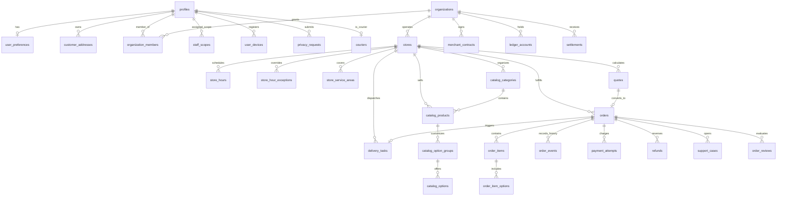
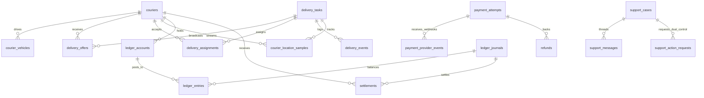

# iDeliveryFood — Entity-Relationship Diagram (ERD)

**Module:** `M02` — Data Platform, Schema, RLS, Storage, Realtime & Seeds  
**Database Engine:** PostgreSQL 17.11 (Supabase Project `dwsoochnfxldfvcaijie`, `us-east-1`)  
**Total Public Tables:** 46 (100% RLS-enabled)

---

## 1. Core Identity, Multi-Tenant Organizations, Catalog & Orders ERD

---

## 2. Logistics, Double-Entry Ledger, Payments & Governance ERD

